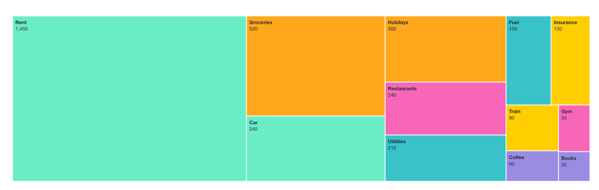
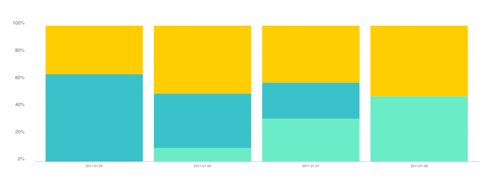
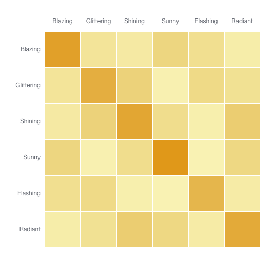

Britecharts 3.0 is here. Pick a chart, give it data, and get a polished visualization with tooltips, animation, loading states and export built in. Version 3 brings screen-reader data tables, keyboard navigation, dark mode, TypeScript types and tools for coding agents to that same idea.

Use it from a script tag, in React, or through the wrappers in your framework of choice. It is free and open source under the Apache 2.0 licence.

```sh
npm install @britecharts/core
```

<!-- truncate -->

## A chart you can put in a product

D3 gives you the tools to build a visualization. Britecharts gives you finished charts built with D3: bars, lines, donuts, stacked areas, scatter plots, heatmaps and more. You choose the chart and supply its data, then use a shared vocabulary of settings to make it fit your page.

That has always been the point of the library. Version 3 takes it further: charts are responsive by default, and loading states are available across the library. A unified tooltip follows the pointer without getting cut off at the chart's edges. You can assign consistent category colours with `colorMap` and control animation timing with `animationDuration`.

These are the details a chart needs once it leaves a demo and becomes part of someone's daily work. They belong in the library, so you can spend your time on what the data means.

## Accessible from the first render

Accessibility is the biggest change in this release. Charts have accessible names, and every data chart renders a visually hidden table so a screen reader can read the values cell by cell. Time series charts arrange that table with a row per date or category and a column per series.

The bar, donut, grouped bar, heatmap, line, scatter plot, stacked area, stacked bar and new treemap also support keyboard navigation by default. Each chart is one tab stop; arrow keys move through the data, Home and End move to the ends, and the tooltip follows focus.

Charts respect `prefers-reduced-motion`, drawing without animation when the reader asks for it. An Okabe–Ito palette is available through `colors.colorSchemas.okabeIto` for readers with colour blindness.

Give a chart a meaningful `a11yTitle` and an `a11yDescription` that explains what to take away from it. If your page already provides a table of the same data, you can turn off the generated table. The [accessibility guide](/docs/how-tos/user-how-to-guides#how-to-make-a-chart-accessible) covers those choices.

## Make it fit your page, and take it with you

Text, axes, grids, tooltips, legends and loading states now get their colours from `--bc-*` CSS custom properties. Change a token to match your design, or let the charts follow your page's colour scheme. Set `color-scheme: light dark` on the page and the charts support dark mode with it.

When someone needs the chart in a report or a presentation, `exportChart()` downloads an SVG or PNG with its styles and an optional title. SVG keeps the chart sharp at any size, and exported images retain the resolved theme colours.

The how-to guides show [theming and dark mode](/docs/how-tos/user-how-to-guides#how-to-theme-a-chart-and-support-dark-mode) and [export](/docs/how-tos/user-how-to-guides#how-to-export-a-chart) in use.

## Use it where you already work

Version 3 splits the library into three packages:

- **`@britecharts/core`** contains the D3 charts and helpers. Use it directly, with a bundler or from a CDN.
- **`@britecharts/wrappers`** provides a configuration-based layer for creating and updating charts, ready to connect to a framework's lifecycle.
- **`@britecharts/react`** provides React components, including the brush, heatmap and new treemap, with React 19 and StrictMode covered by integration tests.

The packages use D3 v7, ship TypeScript types, and support ES modules, CommonJS, UMD and CDN builds. Bundlers can drop charts you do not import. I also checked the published types against runtime behaviour and corrected getters, callbacks and accessors.

## Clear enough for a coding agent, too

Version 3 includes a JSON Schema for each chart spec, shaped as `{ chart, config, data }`, so an editor or agent can validate it before rendering. The wrappers check configuration values and explain mistakes: an unknown `heigth` key gets a suggestion to use `height`, with a link to the chart's API page.

Explicit data shapes and configuration help people writing charts and agents writing them on their behalf.

An agent skill documents the data shapes, settings, events and migration pitfalls. Install it with:

```sh
npx skills add britecharts/britecharts
```

There is also an [llms.txt](pathname:///llms.txt), an index of the docs for coding agents, generated from the same source comments as the API reference. The [chart spec guide](/docs/how-tos/user-how-to-guides#how-to-describe-a-chart-as-a-spec-and-check-it) explains how the pieces fit together.

## More ways to show your data

### A new treemap chart

Added since the last beta, the treemap shows how a total divides into its parts: each rectangle's area is proportional to its value. Use it to compare spending categories in a budget, product revenue or other contributions to a total. It takes a flat array of `{ name, value }` entries and is available in core, the wrappers and React.



The treemap includes labels, tooltips, animated updates, loading states and export, along with a screen-reader data table and keyboard navigation. It follows the same API conventions as the other charts, so there is little new to learn. See the [treemap API reference](/docs/API/treemap) for its options.

### Compare proportions with 100% stacks

The stacked bar and stacked area support `isNormalized(true)`, scaling each stack to 100% so you can compare the mix of categories even when their totals differ.



### Compare categories in a heatmap

The heatmap now accepts `xAxisLabels` as well as `yAxisLabels`, so you can compare any two sets of categories. A square comparison grid is one example:



Version 3 also adds **negative values** in the bar, grouped bar, stacked bar, brush and scatter plot.

The [Storybook](pathname:///storybook/) lets you explore the charts and their options in both core and React.

## Moving from version 2

This is a major release, and there are breaking changes. Start with package imports: charts are now named exports from `@britecharts/core`, replacing the old per-chart paths under `britecharts/dist/umd`.

You will also need to check renamed accessors, replace `loadingState()` with `isLoading(true)`, use the documented data keys, and await `exportChart()`. Charts now add a hidden table and, where supported, a tab stop. If your page already handles either one, turn it off with `a11yDataTable(false)` or `a11yKeyboardNavigation(false)`. CSS overrides may need to move to the new theme tokens.

The [v2-to-v3 migration guide](/docs/how-tos/migration-guide-2-to-3) covers the changes with before-and-after examples, including changes between the betas. Version 2 ends at 2.18.2, and I do not plan to keep patching it after this release.

## Build your first chart, or help build the next release

Start with [installation](/docs/tutorials/installing-britecharts) and [getting started](/docs/tutorials/getting-started), or explore the [API reference](/docs/API/bar) and [how-to guides](/docs/how-tos/user-how-to-guides) if you already know what you want to build.

Thank you to everyone who tried the betas, reported bugs and helped get this release ready. If something breaks, open an [issue](https://github.com/britecharts/britecharts/issues) with the chart, the data and what you expected.

Britecharts also needs maintainers. I have carried most of this release myself, and I would like its next chapter to have more people behind it. If there is a chart, a package or a part of the documentation you would enjoy owning, the [contributing guide](https://github.com/britecharts/britecharts/blob/main/.github/CONTRIBUTING.md) is where to start.
